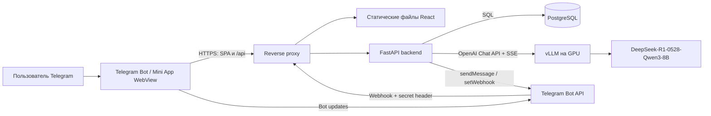
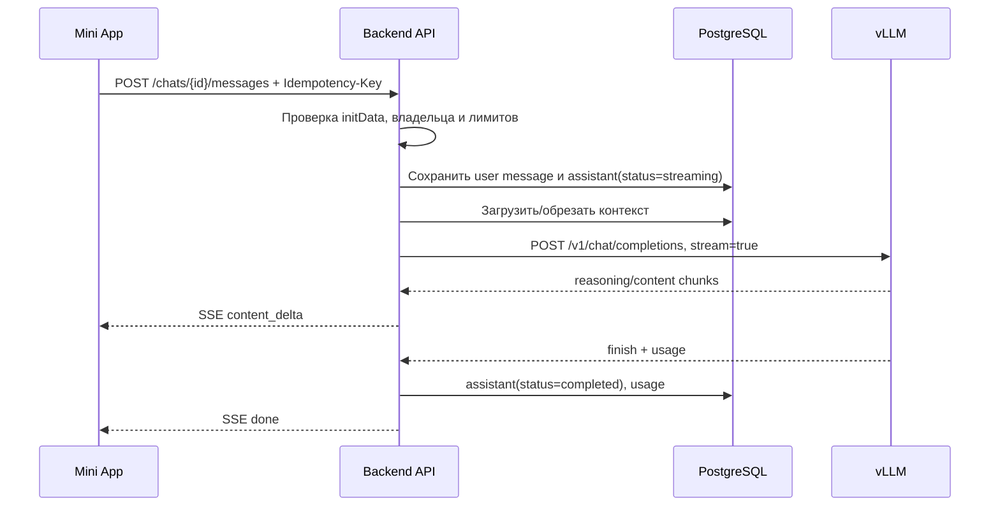

# Архитектура Telegram Mini App с LLM-чатом

Статус: план MVP  
Модель: `deepseek-ai/DeepSeek-R1-0528-Qwen3-8B`  
Inference-сервер: vLLM, OpenAI-совместимый Chat Completions API

## 1. Цель и границы MVP

Пользователь открывает Mini App из уже созданного Telegram-бота, создаёт чат,
отправляет текстовый вопрос и получает потоковый ответ модели. История чатов
сохраняется и доступна только владельцу Telegram-аккаунта.

В MVP входят:

- запуск Mini App через главное приложение/кнопку меню бота и команду `/start`;
- проверка Telegram-пользователя по подписанному `Telegram.WebApp.initData`;
- список чатов, создание, переименование и удаление чата;
- текстовые сообщения, Markdown и блоки кода;
- потоковый ответ, остановка генерации, повтор запроса после ошибки;
- хранение истории и базовые пользовательские лимиты;
- health checks, структурированные логи и метрики vLLM/API.

Не входят в первый релиз: файлы, изображения, голос, web search/RAG, tool
calling, групповые чаты, платежи и переключение моделей.

## 2. Основные архитектурные решения

| Область | Решение для MVP | Причина |
| --- | --- | --- |
| Web-клиент | React + TypeScript + Vite | Небольшой SPA, удобная потоковая отрисовка и Telegram SDK |
| Backend | Python + FastAPI, полностью async | Удобный streaming proxy к vLLM и одна экосистема с inference |
| Telegram Bot API | Отдельный модуль backend; webhook в production, long polling только локально | Не нужен отдельный сервис ради `/start` и кнопки Mini App |
| База | PostgreSQL | Надёжная история и возможность запустить несколько API-реплик |
| Поток ответа | `POST` + `text/event-stream` поверх `fetch()` | Можно передать тело/авторизацию и читать ответ по мере генерации |
| LLM API | `POST /v1/chat/completions`, `stream=true` | vLLM поддерживает OpenAI-совместимый контракт и chat template модели |
| Авторизация | Подписанный `initData` в каждом запросе API | Нет пароля, отдельной регистрации и долгоживущего токена в браузере |
| Размещение | Web и API на одном HTTPS origin; vLLM и PostgreSQL только в приватной сети | Проще CORS/CSP и секреты не попадают на клиент |

Redis не обязателен для первой однорепличной версии. Он добавляется перед
горизонтальным масштабированием для распределённого rate limit, блокировки
одновременных генераций и краткоживущего кэша авторизации.

## 3. Контекстная схема



Доверенная граница проходит перед backend: значения из браузера, включая
`initDataUnsafe`, не считаются достоверными. Клиент никогда не получает
`TELEGRAM_BOT_TOKEN`, `VLLM_API_KEY` или прямой адрес vLLM.

## 4. Компоненты

### 4.1. Telegram Mini App

Ответственность клиента:

- вызвать `Telegram.WebApp.ready()` и при необходимости `expand()`;
- применять Telegram theme variables, safe area и изменение viewport;
- держать исходный `Telegram.WebApp.initData` только в памяти вкладки;
- добавлять его в `Authorization: tma <initData>` ко всем `/api/v1/*` запросам;
- показывать список чатов и оптимистично добавлять сообщение пользователя;
- читать SSE-поток через `fetch()`/`ReadableStream`, дописывая один ответ;
- корректно восстанавливать экран после потери сети или сворачивания WebView;
- рендерить Markdown с HTML sanitization и безопасной подсветкой кода.

На клиенте нужны четыре основных экрана/состояния: загрузка и авторизация,
список чатов, активный чат, ошибка с возможностью повторить действие. Десктопный
режим можно сделать двухколоночным, мобильный — с отдельной страницей списка.

Обычное открытие URL вне Telegram в production возвращает экран «Откройте
приложение в Telegram». Для разработки допускается отдельный явно включаемый
`DEV_AUTH`, который не собирается и не включается в production.

### 4.2. Backend API

Backend делится на модули без выделения микросервисов:

- `auth` — разбор и криптографическая проверка Telegram `initData`;
- `users` — upsert профиля Telegram и `last_seen_at`;
- `chats` — CRUD и обязательная проверка владельца;
- `generations` — контекст, вызов vLLM, поток событий и отмена;
- `llm` — единственный адаптер OpenAI-совместимого API;
- `telegram_bot` — `/start`, кнопка `web_app`, webhook и Bot API;
- `observability` — request ID, логи, метрики и health checks.

Backend не принимает от клиента массив `messages`, имя модели, system prompt
или параметры sampling. Клиент передаёт только `chat_id` и новый текст; историю
и настройки backend формирует сам. Это не позволяет подменить чужую историю,
обойти лимит контекста или произвольно нагрузить GPU.

### 4.3. Telegram-бот

Бот уже создан, поэтому код отвечает только за интеграцию:

- `/start` отправляет кнопку `web_app` с публичным `MINI_APP_URL`;
- главное Mini App и/или Menu Button настраивается через BotFather;
- production endpoint принимает webhook только с корректным
  `X-Telegram-Bot-Api-Secret-Token`;
- обработчики повторных update должны быть идемпотентными;
- локально разрешён long polling, но одновременно с webhook он не запускается.

`TELEGRAM_BOT_TOKEN` подставляется позже через secret/environment. Его нельзя
записывать в репозиторий, frontend variables, Docker image или логи.

### 4.4. vLLM

vLLM работает отдельным процессом/контейнером на GPU-хосте и доступен только
backend. Базовый профиль запуска (точные флаги фиксируются вместе с версией
vLLM после нагрузочного прогона):

```bash
vllm serve deepseek-ai/DeepSeek-R1-0528-Qwen3-8B \
  --host 0.0.0.0 \
  --port 8000 \
  --served-model-name deepseek-r1-8b \
  --api-key "$VLLM_API_KEY" \
  --reasoning-parser deepseek_r1 \
  --dtype auto \
  --max-model-len "$VLLM_MAX_MODEL_LEN"
```

Модель использует конфигурацию и tokenizer именно из её репозитория, а не из
исходного Qwen3. Начальные sampling defaults: `temperature=0.6`,
`max_tokens=LLM_MAX_OUTPUT_TOKENS`; остальные параметры следует менять только
по результатам eval. Значение контекста не надо выставлять выше проверенной
возможности GPU: KV cache и параллельные запросы должны войти в память.

`--reasoning-parser deepseek_r1` отделяет reasoning от финального ответа. Адаптер
backend должен быть привязан к зафиксированной версии vLLM: в актуальном
контракте поле называется `reasoning`, в старых версиях встречается
`reasoning_content`. В историю следующего запроса передаётся только финальный
`content`, а не внутреннее рассуждение.

По умолчанию UI показывает статус «Модель рассуждает», но не сырой reasoning.
Опциональная передача reasoning включается серверным feature flag и отображает
его в свёрнутом блоке; эти данные не сохраняются в MVP.

## 5. Основные потоки

### 5.1. Вход в Mini App

1. Telegram открывает HTTPS URL и передаёт `initData` в WebView.
2. SPA вызывает `GET /api/v1/me` с `Authorization: tma <initData>`.
3. Backend разбирает query string, исключает `hash`, сортирует поля и проверяет
   HMAC-SHA-256 по алгоритму Telegram с `TELEGRAM_BOT_TOKEN`.
4. Backend также проверяет `auth_date` с допустимым возрастом и сравнением
   подписи в constant time.
5. После успешной проверки backend upsert-ит пользователя по 64-битному
   Telegram `user.id` и возвращает безопасный профиль.
6. При любой ошибке подписи запрос завершается `401`; данные из
   `initDataUnsafe` никогда не используются для авторизации.

Для короткого MVP проверка выполняется на каждом запросе. При высокой нагрузке
результат можно ненадолго кэшировать по SHA-256 от полного `initData`, не
сохраняя исходную строку и не продлевая разрешённый срок `auth_date`.

### 5.2. Сообщение и потоковый ответ



Если клиент отключился, backend отменяет upstream HTTP request и переводит
незаконченный ответ в `cancelled` или `failed`. Частичный текст можно показать
до перезагрузки, но он не включается в последующий модельный контекст. В одном
чате допускается только одна активная генерация; второй запрос получает `409`.

Перед вызовом модели backend собирает system prompt и последние завершённые
пары `user/assistant`. Tokenizer этой же модели считает бюджет: резервируется
`LLM_MAX_OUTPUT_TOKENS`, затем удаляются самые старые полные пары. Последнее
сообщение пользователя не обрезается молча: слишком большой ввод получает
`413` с понятным кодом ошибки.

## 6. HTTP API MVP

Все пути ниже имеют префикс `/api/v1` и требуют Telegram-авторизацию, кроме
health checks и Telegram webhook.

| Метод и путь | Назначение | Основной результат |
| --- | --- | --- |
| `GET /me` | Проверить вход и получить профиль | `200 User` |
| `GET /chats?cursor=` | Постраничный список чатов пользователя | `200 {items,next_cursor}` |
| `POST /chats` | Создать чат | `201 Chat` |
| `PATCH /chats/{chat_id}` | Изменить название | `200 Chat` |
| `DELETE /chats/{chat_id}` | Удалить чат и сообщения | `204` |
| `GET /chats/{chat_id}/messages?cursor=` | Получить историю | `200 {items,next_cursor}` |
| `POST /chats/{chat_id}/messages` | Сохранить ввод и начать SSE-генерацию | `200 text/event-stream` |
| `POST /generations/{request_id}/cancel` | Остановить активный ответ | `202` |
| `GET /health/live` | Жив ли процесс API | `200` без внешних проверок |
| `GET /health/ready` | Готовы ли DB и vLLM | `200` или `503` |
| `POST /telegram/webhook` | Получить update от Telegram | `200`, проверяется secret header |

Тело отправки сообщения:

```json
{
  "content": "Объясни, что такое KV cache"
}
```

SSE-события имеют явные имена и JSON payload:

```text
event: message_start
data: {"request_id":"...","user_message_id":"...","assistant_message_id":"..."}

event: content_delta
data: {"delta":"KV cache — это"}

event: done
data: {"finish_reason":"stop","usage":{"prompt_tokens":120,"completion_tokens":80}}
```

Также предусмотрены `reasoning_delta` (только при feature flag), `cancelled` и
`error`. Proxy должен отключить buffering и compression для этого endpoint.
Heartbeat-комментарий отправляется во время долгого reasoning, чтобы WebView и
reverse proxy не закрывали соединение.

`Idempotency-Key` создаётся клиентом для каждой отправки. Повтор с тем же ключом
не создаёт второе пользовательское сообщение и вторую GPU-задачу.

## 7. Модель данных

### `users`

- `telegram_user_id BIGINT PRIMARY KEY`;
- `username`, `first_name`, `last_name`, `language_code` — nullable snapshot;
- `created_at`, `last_seen_at`.

### `chats`

- `id UUID PRIMARY KEY`;
- `owner_telegram_user_id BIGINT NOT NULL REFERENCES users`;
- `title`, `created_at`, `updated_at`;
- индекс `(owner_telegram_user_id, updated_at DESC)`.

### `messages`

- `id UUID PRIMARY KEY`, `chat_id UUID NOT NULL REFERENCES chats ON DELETE CASCADE`;
- `ordinal BIGINT` или другая монотонная позиция внутри чата;
- `role` со значениями `user | assistant`;
- `content TEXT`;
- `status`: `completed | streaming | cancelled | failed`;
- `finish_reason`, `prompt_tokens`, `completion_tokens`, `error_code` — nullable;
- `idempotency_key` для user message, `created_at`, `completed_at`;
- уникальные ограничения `(chat_id, ordinal)` и
  `(chat_id, idempotency_key)` для непустого ключа.

Текст reasoning и полный `initData` в БД не сохраняются. Удаление чата —
физическое для MVP; срок резервных копий должен быть указан в privacy policy.

## 8. Безопасность и ограничения

- В production весь внешний трафик идёт только по HTTPS; Mini App URL должен
  принадлежать контролируемому домену.
- Каждый запрос к объекту проверяет `owner_telegram_user_id`; одного знания UUID
  недостаточно для доступа.
- Сравнение Telegram hash выполняется constant time, `auth_date` имеет
  конфигурируемый небольшой TTL и допустимый clock skew.
- CORS разрешает только публичный origin приложения; предпочтительно вообще
  использовать один origin и relative `/api` URL.
- CSP запрещает произвольные scripts/frames/connections; разрешаются только
  собственный origin и обязательные Telegram-ресурсы.
- Markdown проходит sanitization; ссылки получают безопасные атрибуты. Ответ
  модели считается недоверенным текстом, а не HTML.
- Лимиты задаются по Telegram user ID: размер входа, запросы в минуту,
  одновременные генерации и дневной token budget.
- vLLM защищён API key и сетевым firewall; его порт не публикуется в интернет.
- В логи не попадают bot/vLLM tokens, `initData`, заголовки авторизации и полный
  текст диалогов. Для отладки используются request ID и технические метаданные.
- Ошибки пользователю не раскрывают stack trace, SQL, внутренние адреса и ответ
  vLLM целиком.
- Зависимости и container images фиксируются по версиям; миграции выполняются
  отдельным одноразовым job перед rollout API.

## 9. Надёжность и наблюдаемость

Backend выставляет единый `request_id` на путь Mini App → API → vLLM. Для
generation логируются длительность очереди, time to first token, общая
длительность, finish reason и token usage без текста сообщения.

Минимальные метрики:

- число и доля `2xx/4xx/5xx` запросов API;
- активные SSE/generation, отмены и ошибки vLLM;
- time to first token и tokens/second;
- prompt/completion tokens по пользователю только в агрегированном виде;
- заполнение GPU memory, GPU utilization и длина scheduler queue;
- latency/error rate PostgreSQL.

Backend задаёт отдельные timeout: короткий на подключение к vLLM, увеличенный
на чтение stream и общий предел генерации. До начала SSE допустим ограниченный
retry только при сетевой ошибке; после первого токена автоматический retry
запрещён, чтобы не склеить два разных ответа.

Ежедневный backup PostgreSQL и проверяемое восстановление обязательны до
production. Readiness не направляет трафик на API без БД или готовой модели,
а liveness не зависит от внешних сервисов и не создаёт restart storm.

## 10. Развёртывание

Минимальная production-топология:

1. Reverse proxy (Caddy/Nginx/Traefik) завершает TLS, раздаёт SPA и направляет
   `/api`, `/telegram/webhook` в backend. Для SSE выключает proxy buffering.
2. Один контейнер backend запускает API и webhook handler.
3. PostgreSQL находится во внутренней сети с persistent volume/managed storage.
4. vLLM работает на Linux GPU node с NVIDIA runtime и persistent cache модели.
5. Наружу открыты только `443` и при необходимости `80` для redirect/ACME.

Первый релиз может использовать Docker Compose на одном GPU-сервере. Разнос
API/DB и GPU node не меняет контрактов, если внутренний `VLLM_BASE_URL` остаётся
недоступным снаружи. Горизонтальное масштабирование API потребует Redis или
иного общего механизма rate limit/locks; масштабирование inference — отдельного
vLLM router/load balancer и нагрузочного теста.

### 10.1. Состав Docker Compose

В репозитории должен появиться базовый `compose.yaml` со следующими сервисами:

| Сервис | Обязательность | Назначение |
| --- | --- | --- |
| `postgres` | Всегда | PostgreSQL и persistent volume с историей чатов |
| `migrate` | Всегда, one-shot | Запуск `alembic upgrade head` до старта API |
| `api` | Всегда | FastAPI, Telegram webhook и streaming proxy к LLM |
| `web` | Всегда | Собранный React SPA и локальный HTTP reverse proxy к API |
| `vllm` | Профиль `gpu` | OpenAI-совместимый inference server на NVIDIA GPU |

Отдельный контейнер Telegram-бота в MVP не нужен: webhook и Bot API находятся
в `api`. Отдельный mock-контейнер тоже не нужен: режим `LLM_MODE=mock`
реализуется адаптером backend и воспроизводит SSE chunks без GPU. Redis,
Prometheus и Grafana не включаются в обязательный локальный стек; Redis
добавляется профилем `scale`, когда появятся несколько API-реплик, а сбор метрик
может использовать внешнюю production-систему.

### 10.2. План `compose.yaml`

Ниже — целевой каркас Compose. При реализации значения image tags заменяются на
проверенные и зафиксированные версии; `latest` допустим только для первичного
локального spike.

```yaml
name: octa-oracle

services:
  postgres:
    image: postgres:17-alpine
    restart: unless-stopped
    environment:
      POSTGRES_DB: ${POSTGRES_DB:-octa_oracle}
      POSTGRES_USER: ${POSTGRES_USER:-octa_oracle}
      POSTGRES_PASSWORD: ${POSTGRES_PASSWORD}
    volumes:
      - postgres-data:/var/lib/postgresql/data
    healthcheck:
      test:
        - CMD-SHELL
        - pg_isready -U $${POSTGRES_USER} -d $${POSTGRES_DB}
      interval: 5s
      timeout: 5s
      retries: 20
      start_period: 10s
    networks:
      - backend

  migrate:
    build:
      context: .
      dockerfile: apps/api/Dockerfile
    command: ["alembic", "upgrade", "head"]
    restart: "no"
    env_file:
      - .env
    environment:
      DATABASE_URL: >-
        postgresql+asyncpg://${POSTGRES_USER:-octa_oracle}:${POSTGRES_PASSWORD}@postgres:5432/${POSTGRES_DB:-octa_oracle}
    depends_on:
      postgres:
        condition: service_healthy
    networks:
      - backend

  api:
    build:
      context: .
      dockerfile: apps/api/Dockerfile
    restart: unless-stopped
    env_file:
      - .env
    environment:
      DATABASE_URL: >-
        postgresql+asyncpg://${POSTGRES_USER:-octa_oracle}:${POSTGRES_PASSWORD}@postgres:5432/${POSTGRES_DB:-octa_oracle}
      LLM_MODE: ${LLM_MODE:-mock}
      VLLM_BASE_URL: http://vllm:8000/v1
    depends_on:
      migrate:
        condition: service_completed_successfully
    ports:
      - "127.0.0.1:${API_PORT:-8001}:8000"
    healthcheck:
      test:
        - CMD
        - python
        - -c
        - >-
          import urllib.request;
          urllib.request.urlopen('http://localhost:8000/health/live', timeout=2)
      interval: 10s
      timeout: 3s
      retries: 10
      start_period: 10s
    stop_grace_period: 30s
    networks:
      - backend
      - egress

  web:
    build:
      context: .
      dockerfile: apps/web/Dockerfile
    restart: unless-stopped
    depends_on:
      api:
        condition: service_healthy
    ports:
      - "127.0.0.1:${WEB_PORT:-8080}:80"
    networks:
      - backend
      - egress

  vllm:
    image: ${VLLM_IMAGE:-vllm/vllm-openai:latest}
    profiles: ["gpu"]
    restart: unless-stopped
    command:
      - --model
      - deepseek-ai/DeepSeek-R1-0528-Qwen3-8B
      - --served-model-name
      - deepseek-r1-8b
      - --api-key
      - ${VLLM_API_KEY}
      - --reasoning-parser
      - deepseek_r1
      - --dtype
      - auto
      - --max-model-len
      - ${VLLM_MAX_MODEL_LEN:-8192}
      - --gpu-memory-utilization
      - ${VLLM_GPU_MEMORY_UTILIZATION:-0.90}
    environment:
      HF_TOKEN: ${HF_TOKEN:-}
    gpus: all
    shm_size: 8gb
    volumes:
      - huggingface-cache:/root/.cache/huggingface
      - vllm-cache:/root/.cache/vllm
    ports:
      - "127.0.0.1:${VLLM_PORT:-8000}:8000"
    healthcheck:
      test:
        - CMD
        - python
        - -c
        - >-
          import urllib.request;
          urllib.request.urlopen('http://localhost:8000/health', timeout=3)
      interval: 15s
      timeout: 5s
      retries: 60
      start_period: 10m
    stop_grace_period: 2m
    networks:
      - backend
      - egress

volumes:
  postgres-data:
  huggingface-cache:
  vllm-cache:

networks:
  backend:
    internal: true
  egress:
```

Особенности этого каркаса:

- PostgreSQL не публикует порт на host. Для ручного SQL используется
  `docker compose exec postgres psql ...`.
- Порты API, web и vLLM в локальном режиме привязаны к `127.0.0.1`, поэтому не
  становятся доступны всей локальной сети.
- `backend` изолирует SQL и внутренние HTTP-вызовы; `egress` нужен API для
  Telegram Bot API, а vLLM — для первоначальной загрузки модели.
- `postgres-data` переживает пересоздание контейнера. Два cache volumes не дают
  повторно скачивать веса и компилировать модель после обычного restart.
- `api` ждёт успешных миграций. Он намеренно не имеет `depends_on: vllm`, потому
  что сервис vLLM отсутствует в mock-режиме и может загружать модель несколько
  минут; готовность inference проверяет `/health/ready` самого API.
- Пароль PostgreSQL, bot token и vLLM API key находятся только в `.env`/secret
  storage. В production предпочтительны Compose secrets или secret manager.
- `web` image должен быть multi-stage: Node собирает SPA, минимальный Nginx
  раздаёт статику и проксирует `/api` и `/telegram/webhook` в `api:8000` с
  отключённым buffering для SSE.

### 10.3. Режимы запуска Compose

Проверка приложения без GPU и Telegram выполняется встроенными dev adapters:

```powershell
Copy-Item .env.example .env
docker compose up --build
```

В `.env` для этого режима используются `LLM_MODE=mock` и `DEV_AUTH=true`.
`DEV_AUTH` backend обязан игнорировать, если `APP_ENV=production`.

Полный локальный запуск с vLLM на Windows/Docker Desktop:

```powershell
$env:LLM_MODE = "vllm"
docker compose --profile gpu up --build
```

Перед этим Docker Desktop должен использовать WSL2 backend, а команда проверки
GPU-контейнера должна завершаться успешно:

```powershell
docker run --rm --gpus all nvidia/cuda:12.9.0-base-ubuntu22.04 nvidia-smi
```

При первом старте vLLM скачивает веса и долго остаётся в `starting`; это не
считается ошибкой до истечения `start_period`. Состояние проверяется командами:

```powershell
docker compose ps
docker compose logs -f vllm
Invoke-RestMethod http://localhost:8000/health
```

Для production добавляется `compose.prod.yaml`: убираются локально опубликованные
порты API/vLLM, включается TLS gateway или внешний load balancer, монтируются
secrets и задаются digest-pinned images. Запуск:

```powershell
docker compose -f compose.yaml -f compose.prod.yaml --profile gpu up -d
```

Обычный `docker compose down` сохраняет named volumes. Удаление volumes не должно
быть частью стандартных команд или runbook, поскольку уничтожит локальную БД и
кэши модели.

Исходная модель имеет 8B параметров и BF16 weights. Требования к VRAM нельзя
определять только размером весов: они зависят от длины контекста, KV cache,
batching и параллелизма. Перед production фиксируются результаты benchmark для
целевой GPU. Квантизация рассматривается только отдельным решением после
проверки качества, а не включается незаметно.

## 11. Конфигурация

Обязательные server-side переменные:

```dotenv
APP_ENV=production
DEV_AUTH=false
PUBLIC_BASE_URL=https://chat.example.com
MINI_APP_URL=https://chat.example.com

TELEGRAM_BOT_TOKEN=
TELEGRAM_WEBHOOK_SECRET=
TELEGRAM_INIT_DATA_MAX_AGE_SECONDS=3600

POSTGRES_DB=octa_oracle
POSTGRES_USER=octa_oracle
POSTGRES_PASSWORD=
DATABASE_URL=postgresql+asyncpg://...

LLM_MODE=vllm
VLLM_BASE_URL=http://vllm:8000/v1
VLLM_API_KEY=
VLLM_MODEL=deepseek-r1-8b
VLLM_MAX_MODEL_LEN=8192
VLLM_GPU_MEMORY_UTILIZATION=0.90
HF_TOKEN=
LLM_MAX_OUTPUT_TOKENS=4096
LLM_TEMPERATURE=0.6
SHOW_REASONING=false

MAX_INPUT_CHARS=16000
MAX_CONCURRENT_GENERATIONS_PER_USER=1
RATE_LIMIT_REQUESTS_PER_MINUTE=20
```

Числа являются безопасными стартовыми настройками приложения, а не
гарантированной пропускной способностью. Их нужно согласовать с context limit,
GPU benchmark и ожидаемым количеством пользователей. В репозиторий добавляется
только `.env.example` без значений секретов.

## 12. Предлагаемая структура репозитория

```text
apps/
  web/                    # React/TypeScript Mini App
  api/                    # FastAPI, Telegram webhook и LLM adapter
    app/
      auth/
      chats/
      generations/
      llm/
      telegram_bot/
      db/
compose.yaml              # основной локальный стек и gpu profile
compose.prod.yaml         # production override: TLS, secrets, закрытые порты
infra/
  proxy/                  # TLS и SSE proxy config
migrations/               # PostgreSQL migrations
docs/
  architecture.md
tests/
  integration/            # API ↔ PostgreSQL ↔ fake/real vLLM contracts
```

Это модульный монолит: web, API и vLLM имеют чёткие сетевые границы, но бизнес-
логику преждевременно не дробим на микросервисы.

## 13. План реализации

### Этап 1. Каркас и inference spike

- создать workspace, web/api проекты, lint/typecheck/test и `.env.example`;
- зафиксировать vLLM/container versions и поднять модель на целевой GPU;
- проверить chat template, русский язык, streaming, поле reasoning, отмену и
  ошибки превышения контекста;
- измерить VRAM, TTFT и tokens/s при 1/2/4 одновременных запросах.

Результат: воспроизводимый вызов модели и зафиксированные рабочие лимиты.

### Этап 2. Backend и данные

- миграции `users/chats/messages`;
- валидатор Telegram `initData` с тестовыми векторами, TTL и ownership checks;
- CRUD чатов и сообщений, cursor pagination и idempotency;
- единый формат ошибок и request ID.

Результат: API работает с БД, но LLM пока можно заменить fake adapter.

### Этап 3. Поток генерации

- async vLLM adapter и сбор контекста по token budget;
- SSE events, heartbeat, cancellation и фиксация статусов сообщений;
- rate limit/concurrency guard и обработка обрыва клиента;
- интеграционные тесты на частичные chunks, timeout и upstream `5xx`.

Результат: один пользователь получает устойчивый потоковый ответ без дублей.

### Этап 4. Mini App и бот

- Telegram SDK initialization, theme/safe-area и error states;
- список/экран чата, Markdown/code, streaming UX и кнопка Stop;
- `/start`, `web_app` button, webhook secret и настройка Menu/Main Mini App;
- ручная проверка на Telegram iOS, Android, Desktop и Web.

Результат: полный пользовательский сценарий внутри Telegram.

### Этап 5. Production hardening

- HTTPS/reverse proxy, CSP, CORS, secret injection и закрытая сеть vLLM;
- метрики, dashboards, alerts, backup/restore и retention policy;
- нагрузочный тест, подбор vLLM concurrency/KV cache и пользовательских квот;
- deploy/rollback runbook и smoke test после релиза.

Результат: наблюдаемый и восстанавливаемый production MVP.

## 14. Критерии готовности MVP

- Пользователь запускает приложение кнопкой бота без отдельной регистрации.
- Поддельный, изменённый или просроченный `initData` всегда получает `401`.
- Пользователь не может прочитать, изменить или удалить чужой чат.
- Первый фрагмент ответа появляется потоково; Stop действительно прекращает
  GPU-запрос, а не только скрывает текст на клиенте.
- Повторная отправка с тем же `Idempotency-Key` не создаёт дубль.
- После перезагрузки видны только завершённые сообщения; незавершённые имеют
  корректный статус и не попадают в контекст.
- Секреты и полный текст диалогов отсутствуют в frontend bundle и логах.
- vLLM и PostgreSQL недоступны из публичной сети.
- Пройдены smoke tests в основных клиентах Telegram и восстановление из backup.

## 15. Первичные источники

- [Telegram Mini Apps: инициализация, запуск и проверка initData](https://core.telegram.org/bots/webapps)
- [vLLM: OpenAI-compatible server](https://docs.vllm.ai/en/latest/serving/online_serving/openai_compatible_server/)
- [vLLM: reasoning outputs](https://docs.vllm.ai/en/latest/features/reasoning_outputs/)
- [vLLM: официальный Docker image](https://docs.vllm.ai/en/latest/deployment/docker/)
- [Docker Compose: доступ контейнера к GPU](https://docs.docker.com/compose/how-tos/gpu-support/)
- [Docker Compose: health checks и порядок запуска](https://docs.docker.com/compose/how-tos/startup-order/)
- [Карточка DeepSeek-R1-0528-Qwen3-8B и рекомендации запуска](https://huggingface.co/deepseek-ai/DeepSeek-R1-0528-Qwen3-8B)
